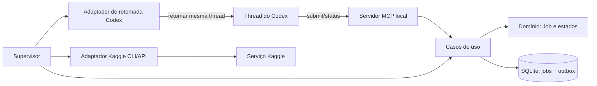

# Monitor local de execuções Kaggle para o Codex

Este projeto propõe uma camada local para acompanhar execuções Kaggle sem manter o agente do Codex em polling. O agente envia um job e recebe um `job_id`; um supervisor local acompanha a execução sem invocar o modelo e, ao final, tenta entregar o resultado na conversa original.

## Decisões aprovadas

- O fluxo é assíncrono; uma ferramenta que mantém o agente esperando não atende ao objetivo.
- A stack principal será TypeScript/Node.js em um monólito local modular.
- O serviço deve operar enquanto o Codex estiver aberto e reconciliar jobs persistidos ao iniciar novamente.
- Go fica disponível para módulos isolados somente se benchmark reproduzível mostrar um gargalo que justifique a fronteira adicional.
- Python não faz parte desta proposta.
- Retomar a conversa original é requisito. Um chat paralelo ou uma notificação sem continuação não substitui esse comportamento.

## Arquitetura proposta

O servidor MCP local expõe ferramentas de submissão e consulta. Um supervisor acompanha o Kaggle pela CLI/API, persiste o ciclo de vida em SQLite e cria um evento de conclusão durável. Um adaptador Codex tenta entregar esse evento à thread que originou o job.

Os limites entre os componentes, o fluxo, os estados, os padrões, as falhas e o modelo de ameaças estão em [docs/architecture.md](docs/architecture.md). As decisões duradouras ficam em [docs/decisions/ADR-001-modular-monolith-typescript.md](docs/decisions/ADR-001-modular-monolith-typescript.md).

## Contribuições e segurança

Todas as contribuições devem entrar por pull request, passar pelos checks de segurança e receber sua aprovação como Code Owner. Consulte [CONTRIBUTING.md](CONTRIBUTING.md) e [SECURITY.md](SECURITY.md). O repositório é público e está sem licença por enquanto; visibilidade pública não concede licença de reutilização.

## Gate antes da implementação completa

Fazer um spike pequeno para provar que a integração consegue: (1) identificar a thread que chamou a ferramenta; (2) retomar a mesma conversa visível no Codex desktop; e (3) enfileirar uma conclusão enquanto houver outro turno ativo. Se qualquer ponto falhar, a implementação do supervisor completo fica parada até existir um caminho suportado que satisfaça o requisito.

Nenhuma implementação do serviço foi iniciada. A instalação de Go é apenas uma preparação de ambiente e não muda a decisão de stack.
