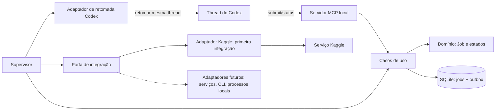

# Supervisor local de processos assíncronos para o Codex

Este projeto propõe um supervisor local que acompanha trabalhos demorados fora do ciclo do modelo e avisa o Codex quando há um resultado. O problema que originou a ideia foi a integração com o Kaggle: depois de iniciar um notebook, o agente precisava consultar repetidamente o status do serviço. Esse polling mantinha turnos ativos, consumia tokens e limites, atrasava outros trabalhos e desperdiçava chamadas enquanto nada havia mudado.

O agente deve iniciar o trabalho e continuar com outras tarefas. Um processo local monitora o trabalho sem invocar o modelo e, quando há uma mudança relevante ou conclusão, tenta entregar um evento à conversa original do Codex. O Codex precisa permanecer aberto durante o monitoramento; jobs persistidos são reconciliados quando o supervisor volta a iniciar.

Kaggle é a primeira integração prevista, não o limite do produto. A arquitetura deve permitir adicionar adaptadores para outros serviços de jobs, ferramentas CLI e processos locais demorados, mantendo um ciclo de vida e uma entrega de eventos consistentes. Cada integração preserva suas capacidades e semântica próprias; o núcleo não deve esconder diferenças importantes em uma abstração genérica.

## Decisões aprovadas

- O fluxo é assíncrono; uma ferramenta que mantém o agente esperando não atende ao objetivo.
- A stack principal será TypeScript/Node.js em um monólito local modular.
- O serviço deve operar enquanto o Codex estiver aberto e reconciliar jobs persistidos ao iniciar novamente.
- Go fica disponível para módulos isolados somente se benchmark reproduzível mostrar um gargalo que justifique a fronteira adicional.
- Python não faz parte desta proposta.
- Retomar a conversa original é requisito. Um chat paralelo ou uma notificação sem continuação não substitui esse comportamento.

## Arquitetura proposta

O servidor MCP local expõe ferramentas para registrar e consultar trabalhos. Um supervisor coordena adaptadores de integração, persiste o ciclo de vida em SQLite e cria eventos duráveis. Um adaptador Codex tenta entregar esses eventos à thread que originou o trabalho.

Os limites entre os componentes, o fluxo, os estados, os padrões, as falhas e o modelo de ameaças estão em [docs/architecture.md](docs/architecture.md). As decisões duradouras ficam em [ADR-001](docs/decisions/ADR-001-modular-monolith-typescript.md) e [ADR-002](docs/decisions/ADR-002-provider-agnostic-integrations.md).

## Contribuições e segurança

Todas as contribuições devem entrar por pull request, passar pelos checks de segurança e receber sua aprovação como Code Owner. Consulte [CONTRIBUTING.md](CONTRIBUTING.md) e [SECURITY.md](SECURITY.md). O repositório é público e está sem licença por enquanto; visibilidade pública não concede licença de reutilização.

## Gate antes da implementação completa

Fazer um spike pequeno para provar que a integração consegue: (1) identificar a thread que chamou a ferramenta; (2) retomar a mesma conversa visível no Codex desktop; e (3) enfileirar uma conclusão enquanto houver outro turno ativo. Se qualquer ponto falhar, a implementação do supervisor completo fica parada até existir um caminho suportado que satisfaça o requisito.

Nenhuma implementação do serviço foi iniciada. A instalação de Go é apenas uma preparação de ambiente e não muda a decisão de stack.
